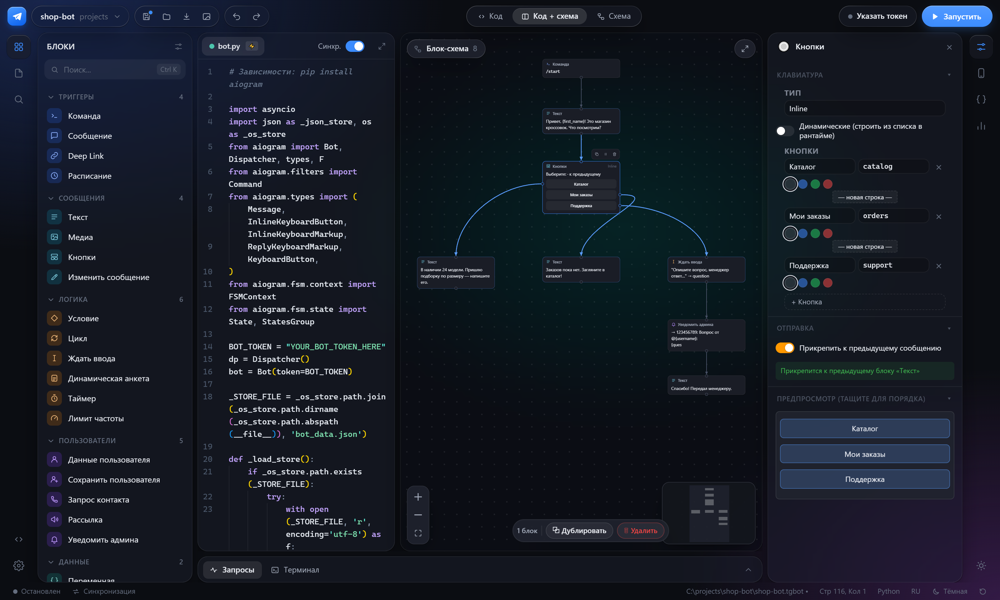

# TG Bot Builder

Программа, в которой Telegram-бота можно собрать из блоков, как схему, а можно написать кодом. Схема и код связаны: двигаешь блоки, и код на aiogram пересобирается сам. Правишь код, и схема перестраивается по нему.



Делал, потому что надоело в каждом простом боте заново писать одно и то же: /start, меню из кнопок, анкету, уведомление админу. Здесь это пять блоков и пара стрелок.

Кроме схемы есть свой симулятор Telegram, чтобы погонять бота без настоящего аккаунта, журнал запросов к боту, терминал, git и свои блоки на Python. Бот запускается прямо из окна кнопкой «Запустить», нужен только токен от @BotFather.

## Запуск

Нужны Node.js 18+ и Python 3.10+ (на нём работает сам бот).

```
npm install
npm start
```

Установщик для Windows: `npm run dist:installer`.

Electron, React, React Flow, Monaco.
